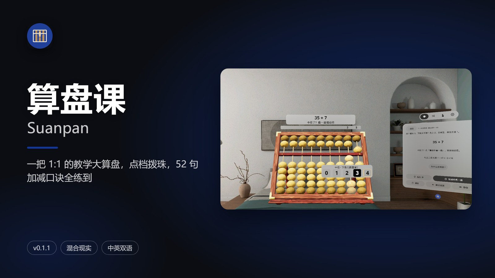
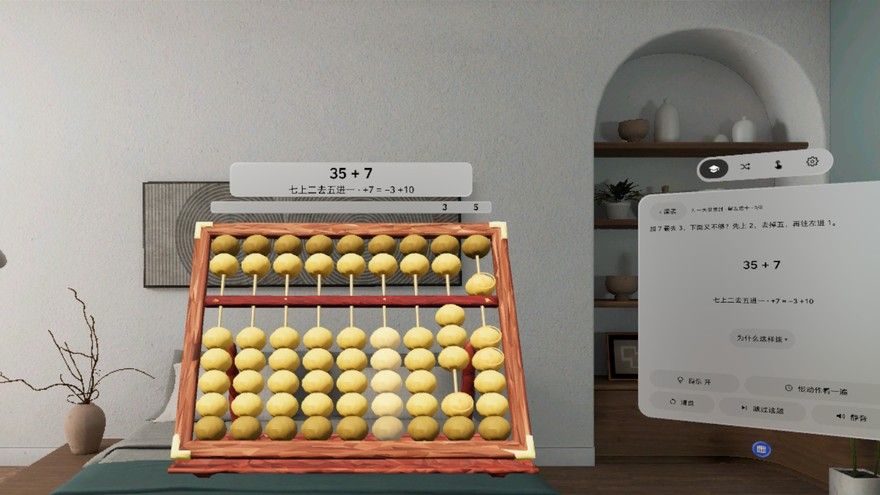
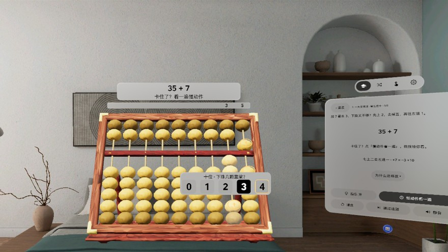
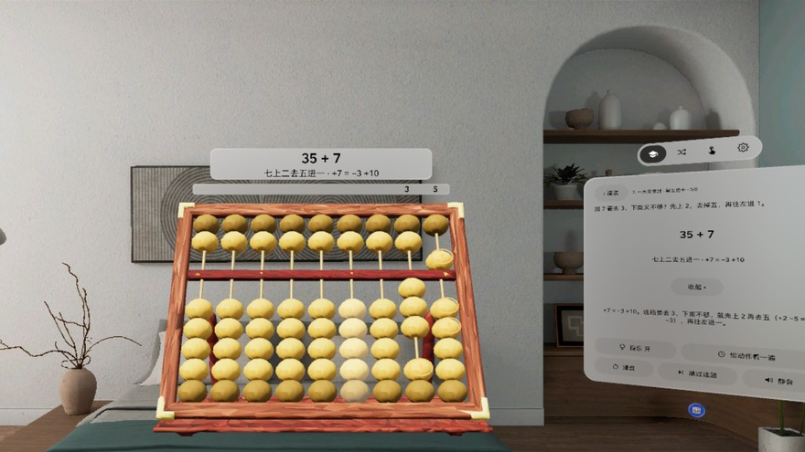
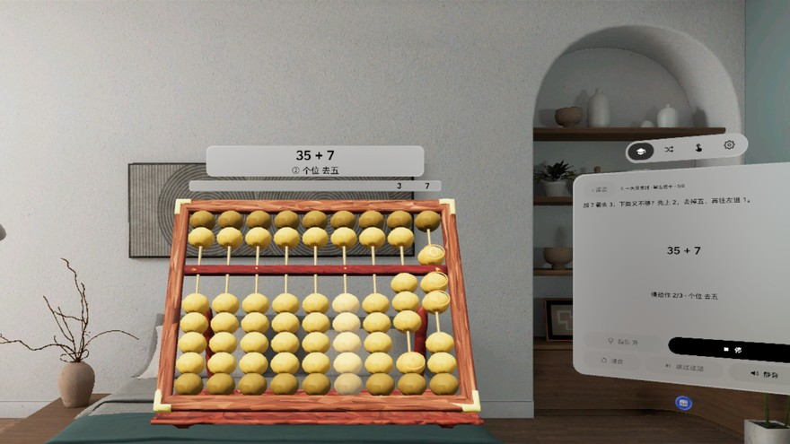
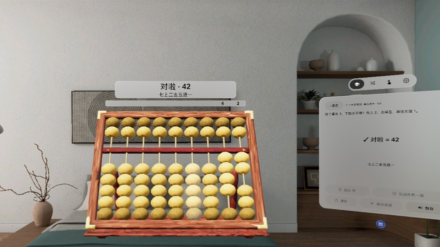
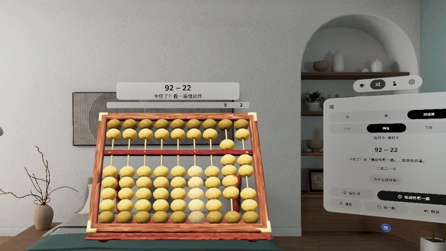
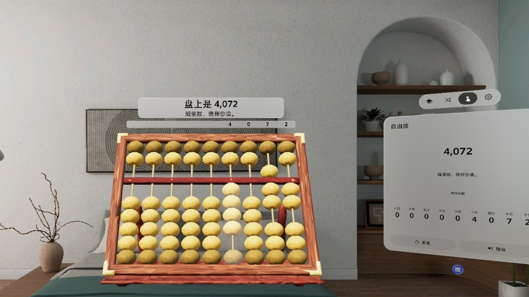
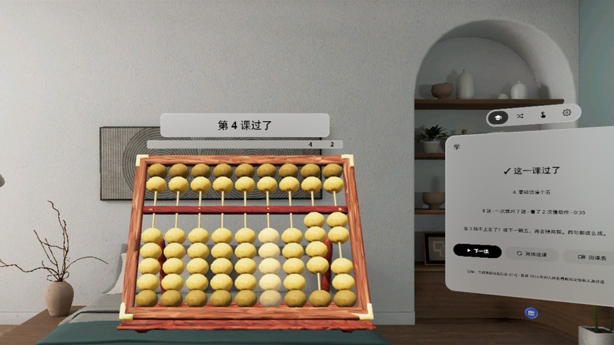

# 算盘课 Suanpan



> **模拟器 QA 通过，真机未验证（Simulator-QA passed; not yet verified on a real headset）**

**装到头显 / Install on a headset**（PICO OS 6，开发者模式，USB 连电脑）：从 [Release v0.1.2](https://github.com/kejing-dev/Suanpan/releases/tag/v0.1.2) 下载 `suanpan-abacus-v0.1.2-debug.apk`，然后：

```bash
adb install -r suanpan-abacus-v0.1.2-debug.apk
pico-cli app launch io.embodit.suanpan
# 没有 pico-cli 时 / without pico-cli:
adb shell monkey -p io.embodit.suanpan -c android.intent.category.LAUNCHER 1
```

[中文](#中文) · [English](#english)

---

## 中文

**一把 1:1 的 9 档教学大算盘摆在你面前，上二下五。出一道题、你点档拨珠，拨对了整排珠子亮一下；每道题都告诉你这句口诀为什么这么拨，还能看一遍慢动作。10 课 80 题，52 句加减口诀全练到。**

PICO 空间应用（PICO OS 6 · Spatial SDK 6.1.9 · Shared Space 体积窗口 + 控制窗）。算盘装在系统立体窗口里，用窗口下方的系统控制条拖到哪就停在哪；右边一块控制窗，四页：学 / 练 / 自由拨 / 设置。

### 能做什么

- **点档拨珠（v0.1.1 两段式）**：注视 + 捏合（或手柄射线 + 扳机）点一档。点上档，上珠直接翻上 / 翻下；点下档，档前弹出 0–4 的数字键，选「几颗靠梁」，珠子成组滑过去。两只手柄可以同时拨不同的档
- **10 课 80 题**：从「掌柜递来一把算盘」到「月底对账」，按商铺一天的故事串起来，52 句珠算加减口诀全部练到
- **每题讲原理**：「为什么这样拨」展开一句话解释（例：+7 = −3 +10，这档要去 3，下面不够，就先上 2 再去五，再往左进一）；卡住了点「慢动作看一遍」，算盘一颗一颗拨给你看
- **判题宽容**：只看盘面数值，口诀里的几步顺序不限；拨错了提示「哪几档还不对」
- **练**：加 / 减 / 加减混合 × 一位 / 两位 / 三位，题目无限
- **自由拨**：随便拨，盘上读数和每档的位名（个、十、百……）实时显示
- 设置：中文 / English / 跟随系统、声音、默认开提示、档上方显示数字、减少动效、重开控制窗、清掉学习进度、退出应用（都有二次确认）
- 全离线，不联网、不要账号；木头珠子相碰的声音来自 CC0 录音

### 截图

> 截图来自 PICO 原生模拟器 6.1（v0.1.1，非高清画质，中文界面），由调试广播驱动跳到各状态，**非真实手势录像**。

| | |
|---|---|
|  出题 35 + 7，题目条上是口诀「七上二去五进一」 |  v0.1.1：点下档弹出 0–4 数字键，选几颗靠梁 |
|  展开「为什么这样拨」 |  慢动作：一步一步拨给你看 |
|  拨对了：对啦 = 42 |  练：两位数加减，题目无限 |
|  自由拨：读数 4,072 + 每档位名 |  一课过关 |

演示视频（Release 资产 `Suanpan-v0.1.0-demo.mp4`，45 s，无声）是 **v0.1.0 录的旧版**（那时还没有数字键，拨珠是直接点珠子），同样是原生模拟器 + 调试输入驱动，非真实手势录像。

### 已知问题

1. 模拟器默认头位姿下，控制窗右缘约 5% 超出视野，设置页的开关被切掉几个像素（真机视野更宽，待真机确认）。
2. 数字键打开时会盖住下档中部一排珠子，选完就收起。
3. 从左右 30° 斜着看时，档的可点目标只有约 1.54°（正面默认位置 ≥ 2.09°）。
4. 模拟器冷启动约 7.6 s 才出窗口；在模拟器上点得慢时会误进「卡住了」提示。
5. 截图非高清。
6. **真机未验证**：头显上的点按命中率、眼手 / 手柄手感、声音都还没在真机上看过。

### 版本

- **v0.1.1**：拨珠改成两段式（点档 → 上档直接翻、下档用 0–4 数字键选几颗靠梁），整把算盘放大 1.5 倍，可点目标在默认位置都 ≥ 2°、间隙 ≥ 2.2 cm（QA 第 1 轮打回的点珠太小问题）；题目条英文不再缩字溢出、练页选项对比度提高。QA 第 2 轮模拟器复查通过。
- v0.1.0：首个版本（模拟器 QA 第 1 轮打回）。

### 构建

```bash
./gradlew assembleDebug testDebugUnitTest
```

需要 JDK 17+、Android SDK（minSdk 35）。36 条单测：口诀引擎对 80 题、52 句口诀，判题、练习出题、进度、可点目标尺寸 / 视角 / 间隙、模型校准。调试广播命令见 [AGENTS.md](AGENTS.md)。

### 素材

- 算盘模型（框、梁、珠、木座、背撑）：Tripo 生成后减面、校准（`tools/prep_models.py`）
- 音效：CC0 录音（freesound）拼接
- 图标：Material Symbols / Material Icons（Apache License 2.0）

---

## English

**A life-size 9-rod teaching abacus (2 upper beads, 5 lower) sits in front of you. Get a sum, tap a rod to move the beads, and the row lights up when it is right. Every sum tells you why the rhyme works, with a slow-motion replay. Ten lessons, 80 sums, all 52 addition and subtraction rhymes.**

PICO spatial app (PICO OS 6 · Spatial SDK 6.1.9 · Shared Space volume + control window). The abacus lives in a system volume you move with the system bar under it; a control window on the right has four tabs: Learn / Practice / Free / Settings.

### Features

- **Two-step bead input (v0.1.1)**: look + pinch (or controller ray + trigger) on a rod. The upper deck flips the five-bead; the lower deck opens a 0–4 key row to choose how many beads touch the beam, and they slide as a group. Two controllers can work two rods at once
- **10 lessons, 80 sums** told as a shopkeeper's day, covering all 52 abacus rhymes
- **Why it works**: each sum explains its rhyme in one line; stuck? "Watch it slowly" replays the beads one by one
- **Forgiving judge**: only the board's value counts, any order inside a rhyme; wrong moves get "these rods are not right yet"
- **Practice**: add / subtract / mixed × 1–3 digits, endless
- **Free play** with a live reading and place names per rod
- Settings: Chinese / English / system, sound, hints on by default, digits above rods, reduced motion, reopen the control window, reset progress, exit (all with confirmation)
- Fully offline, no account; bead clicks are CC0 recordings

### Screenshots

See the gallery above. They were taken on the native PICO emulator 6.1 (v0.1.1, not HD, Chinese UI) driven by debug broadcasts: **not a recording of real hand gestures**. The demo video in the Release (`Suanpan-v0.1.0-demo.mp4`) is from **v0.1.0**, before the 0–4 key row.

### Known issues

1. On the emulator's default head pose the control window's right edge (about 5 %) is outside the view; the settings toggles are clipped by a few pixels.
2. The 0–4 key row covers the middle of the lower beads while it is open; it closes after you choose.
3. Seen 30° from the side, a rod target is only about 1.54° (≥ 2.09° from the default front position).
4. Emulator cold start takes about 7.6 s; slow taps on the emulator can trigger the "stuck?" hint.
5. Screenshots are not HD.
6. **Not yet verified on a real headset**: hit rate, eye-hand / controller feel and sound are unchecked on device.

### Versions

- **v0.1.1**: two-step bead input (tap a rod; the lower deck uses a 0–4 key row), abacus scaled ×1.5 so every target is ≥ 2° with ≥ 2.2 cm gaps at the default position; English problem strip and practice-tab contrast fixed. Passed QA round 2 on the emulator.
- v0.1.0: first build (sent back by QA round 1).

### Build

```bash
./gradlew assembleDebug testDebugUnitTest
```

JDK 17+, Android SDK (minSdk 35). Debug broadcast commands are in [AGENTS.md](AGENTS.md).

## License

Source code © 2026 kejing-dev, all rights reserved unless stated otherwise. Icons: Material Symbols / Material Icons (Apache License 2.0). Sounds: CC0.
